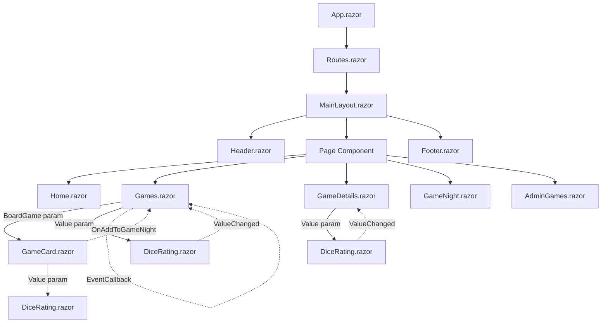
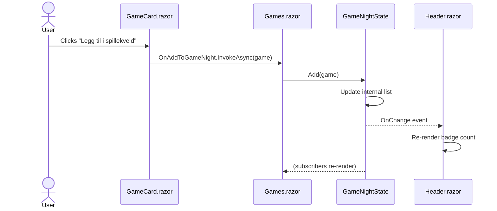

# Design Documentation — Kafé Terningkast

This file covers Oppgave 5: design models, data flow, responsibilities, and
design trade-offs. The README covers how to build and run the app; this file
covers *why* it is built the way it is.

---

## 1. Page Overview

| Route              | Page Component      | Purpose                                                       |
|--------------------|---------------------|---------------------------------------------------------------|
| `/`                | `Home.razor`        | Landing page with CTA buttons to the shelf and game night     |
| `/games`           | `Games.razor`       | Browse, search, filter, and dice-roll the game collection     |
| `/games/{Id:int}`  | `GameDetails.razor` | One game's full details, dice rating, add to game night       |
| `/game-night`      | `GameNight.razor`   | Games selected for tonight with total playtime                |
| `/admin/games`     | `AdminGames.razor`  | Staff CRUD against the REST API                               |
| `*`                | `NotFound.razor`    | Fallback for unknown routes                                   |

---

## 2. Component Tree

*(Rendered with Mermaid. Solid arrows are parameters, dotted arrows are
`EventCallback`s — see the conventions below.)*

**Conventions:**
- Solid arrows = parameters (data flows **down**).
- Dotted arrows = `EventCallback` (events flow **up**).
- The parent owns the data; the child renders it and reports events.

---

## 3. Data Flow — "Add to game night"

*(The “add to game night” flow. `GameNightState` is scoped, so it
survives navigation; subscribers re-render on `OnChange`.)*

---

## 4. Responsibilities

One sentence per component and service.

| Unit                | Responsibility                                                               |
|---------------------|------------------------------------------------------------------------------|
| `App.razor`         | Root HTML shell and `<Routes>` host                                          |
| `Routes.razor`      | Maps URL to page component                                                   |
| `MainLayout.razor`  | Page shell: header, main content slot, footer                                |
| `Header.razor`      | Top navigation with active-link highlighting and game-night badge            |
| `Footer.razor`      | Secondary navigation and copyright                                           |
| `Home.razor`        | Landing page with links into the app                                         |
| `Games.razor`       | Owns local shelf state (search, filter, rolled game) and filters the catalog |
| `GameCard.razor`    | Renders one game and raises events to its parent                             |
| `GameDetails.razor` | Loads one game by route `Id`, hosts a clickable `DiceRating`                 |
| `DiceRating.razor`  | Renders 1–6 dice faces; communicates via `Value`/`ValueChanged`/`ReadOnly`   |
| `GameNight.razor`   | Displays the current game night from `GameNightState`                        |
| `AdminGames.razor`  | CRUD form against `GameApiClient`                                            |
| `GameDbContext`     | EF Core session with the SQLite database                                     |
| `GameEndpoints`     | Maps `/api/games` CRUD routes onto `GameDbContext`                           |
| `GameApiClient`     | All HTTP calls to the REST API                                               |
| `BoardGameValidator`| Server-side validation for create/update; mirrors the DB check constraints   |
| `GameNightState`    | App-wide state (Scoped); survives navigation                                 |
| `GameData`          | Legacy in-memory catalog; superseded by the API (kept as fallback)           |
| `SeedData`          | Idempotent seed for the initial game collection                              |

---

## 5. Design Decisions

Each decision below lists the problem, the alternatives considered, the
choice, and the cost of that choice.

### 5.1 Sharing game-night state across pages

**Problem.** Games added on `/games` must appear on `/game-night` and in the
header badge. The state must survive navigation between pages.

**Alternatives.**

1. **Parameters and `EventCallback` through every level.** Pass the list down
   and events up through `MainLayout` → `Header`, `Games` → `GameCard`, etc.
2. **Cascading values.** Wrap the tree in `<CascadingValue>` and let
   descendants read the state.
3. **A `Scoped` state service (`GameNightState`).** Register once in DI;
   inject wherever needed.

**Choice.** Option 3.

**Why.**
- The state is genuinely app-wide, not a property of one subtree.
- Two unrelated branches (header and game-night page) both need it. Cascades
  are awkward across layout/page boundaries.
- A service is trivially testable in a plain xUnit test.

**Cost.** Subscribers must unsubscribe in `Dispose`, or they leak across
circuits. This is handled by implementing `IDisposable` on components that
subscribe.

---

### 5.2 Rendering mode

**Problem.** Choose how the Blazor app renders: Server, WebAssembly, or Auto.

**Alternatives.**

1. **Interactive Server.** Components run on the server; UI events round-trip
   over SignalR.
2. **Interactive WebAssembly.** Components run in the browser; the app downloads
   the .NET runtime.
3. **Auto.** Start on Server, switch to WebAssembly after first load.

**Choice.** Interactive Server.

**Why.**
- `GameNightState` as a `Scoped` service is straightforward: one instance per
  circuit.
- `HttpClient` to a co-hosted API means no CORS and no duplicated DTOs.
- No cold-start download of the .NET runtime for café guests on slow WiFi.

**Cost.** Every interaction requires a live SignalR connection and a round-trip
to the server. If the connection drops, the UI freezes. For a café-internal
tool, acceptable.

**What would be different with WebAssembly.** `GameNightState` would need to
live in browser memory (or `localStorage`) instead of a server-side service,
and DI scoping rules would be different. Data would also have to cross the
network boundary to reach the API.

---

### 5.3 Database access: `GameDbContext` vs. raw SQL vs. a repository

**Problem.** Persist the game collection locally without a server.

**Alternatives.**

1. **In-memory list** (the assignment's starting point). Simplest, but no
   persistence.
2. **Raw SQL via `Microsoft.Data.Sqlite`.** Full control, no ORM.
3. **EF Core + SQLite, via `GameDbContext` injected into the API endpoints.**
4. **EF Core + SQLite, wrapped in a repository interface.** Adds an abstraction
   layer that hides EF.

**Choice.** Option 3.

**Why.**
- EF Core maps `BoardGame` to a table with no manual SQL.
- Migrations are code, checked into Git — schema and app evolve together.
- Both reads and writes go through `GameApiClient` → `GameEndpoints`, so the
  SQLite database is the single source of truth.
- Check constraints in `OnModelCreating` mirror the UI validation rules, giving
  defence in depth.
- A repository abstraction (Option 4) is overkill for a single-entity app with
  one data source. It would add indirection without a second implementation to
  justify it.

**Cost.** EF Core has a learning curve, and switching to Postgres later means
changing the provider and regenerating migrations. The `GameDbContext` API is
stable enough that a future swap is contained.

---

## 6. What Would Be Easy vs. Hard to Change

**Easy.**

- **Adding a new field to `BoardGame`.** Add the property, add a validation
  rule in `BoardGameValidator` (and the admin form), run `dotnet ef migrations
  add AddField`, and apply. EF handles the schema change.
- **Changing the seed data.** Edit `Data/SeedData.cs` and reset the `.db` file.

**Harder.**

- **Swapping SQLite for Postgres.** The EF Core abstraction helps, but:
  connection string changes, the provider package changes, migrations are
  provider-specific and must be regenerated, and any SQLite-specific behavior
  (e.g. `PRAGMA`) would need review.
- **Making the app multi-tenant or multi-user with per-user game nights.** The
  current `GameNightState` is `Scoped` per circuit. Persisting it per user
  would require authentication, a `UserId` on the state, and storage — a
  significant change.

---

## 7. Known Limitations

- **SQLite file is local.** Not shared between machines. A real deployment
  would use a server database.
- **No authentication.** `/admin/games` is public.
- **Game night is per-circuit, not per-user.** Two tabs in the same session
  share it; two users on different sessions do not.
- **No offline support.** Interactive Server requires SignalR.

---
